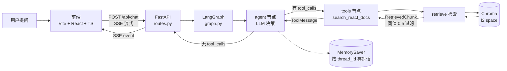

# DevBuddy

> 一个基于 React 官方文档的 RAG 问答 Agent。用户提问 → 检索文档 → 带来源作答，支持多轮对话和流式输出。

**状态**：实验阶段（M1 里程碑进行中）· 最后更新 2026-10-30

**三个亮点**（面试官通常只记住三个）：

1. **检索结果用显式类型** `RetrievedChunk`，不往 `Document.metadata` 里塞分数——避免原地改共享对象的副作用
2. **阈值是实测校准的**，不是拍脑袋：无关 query 相似度上限 0.4717 / 相关 query 下限 0.6940，阈值 0.5 落在断层内
3. **Agent 用 LangGraph 显式建图**，带递归上限和异常分层——不是一个黑盒 `AgentExecutor`

---

## 架构



**关键点**：`tools` 执行完会**回到** `agent`，这是 agent 能"多轮决策"的原因，也是必须用 LangGraph 而非 LangChain 链的原因——链是单向的，走不到回头路。

---

## 快速开始

### 环境要求

- Python 3.12
- Node.js 18+
- BGE-M3 模型权重（约 2.2GB），默认路径 `D:\AI\store\models\bge-m3`

### 1. 后端

```bash
cd agent

# 安装依赖
python -m pip install -r requirements.txt

# 配置环境变量
copy .env.example .env
# 编辑 .env，填入 AGNES_API_KEY 和 SILICONFLOW_API_KEY

# 构建向量库（首次必做，读 data/*.md 写入 chroma_db/）
python -m app.rag.vectorstore

# 跑测试（应该是 13 passed）
python -m pytest tests -q

# 启动服务
python -m uvicorn app.api.main:app --reload --port 8899
```

> ⚠️ **端口必须用 8899**。前端 `vite.config.ts` 的 proxy target 写死了 `http://localhost:8899`，用 8000 会连不上。（`main.py` 文档字符串里写的是 8000，那是历史遗留的不一致，见「已知限制」。）

### 2. 前端

```bash
cd devbuddy-web

npm install
npm run dev
```

打开 http://localhost:5173

### 3. 命令行直接测（不启前端）

```bash
cd agent
python -c "from app.agent.graph import chat; print(chat('useState 是什么'))"
```

---

## 目录结构

```
DevBuddy/
├── agent/                       后端
│   ├── app/
│   │   ├── core/config.py       配置：.env 读取、阈值、top_k、日志
│   │   ├── rag/
│   │   │   ├── loader.py        加载 Markdown + 两步切块（标题 → 字符）
│   │   │   ├── vectorstore.py   Chroma 构建/获取，embedding 单例
│   │   │   ├── retriever.py     检索 + 阈值过滤 → RetrievedChunk
│   │   │   └── schemas.py       RetrievedChunk 类型定义
│   │   ├── agent/graph.py       LLM + 工具 + LangGraph 图 + SSE 流
│   │   └── api/
│   │       ├── main.py          FastAPI 入口 + CORS
│   │       └── routes.py        /api/chat SSE 路由
│   ├── data/                    5 篇 React 官方文档（源数据）
│   ├── tests/                   13 个用例（conftest 造假向量库，不加载模型）
│   ├── practice/                探索脚本（探针、attention 手推等）
│   └── requirements.txt
├── devbuddy-web/                前端（Vite + React + TS）
│   └── src/hooks/useSSE.ts      SSE 客户端 + conversation_id 管理
└── 工程债.md                    28 条技术债清单（P0–P4 分级）
```

---

## 核心设计（ADR）

每个决策六段式：**背景 / 决策 / 理由 / 备选方案（为什么否）/ 后果（代价）/ 状态**。

### ADR-001 向量库选型：Chroma

**背景**：本地开发，希望零外部依赖、开箱即用；知识库只有 5 篇文档、222 个 chunk，数据量极小。

**决策**：`chromadb.PersistentClient` + LangChain 的 `Chroma` 封装。

**理由**：pip 装完即用，不用起服务；LangChain 原生集成（`from_documents` 一行入库）；支持 metadata 过滤；数据持久化到磁盘，重启不用重算向量。

**备选方案**：
- **FAISS**：性能好，但无内置持久化、无 metadata 过滤，要自己写序列化。
- **Qdrant / pgvector**：生产级，但要额外起服务，本地开发成本高。

**后果（代价）**：
- 单机够用；数据量大或要高并发时要迁移。
- **额外代价（重要）**：Chroma 默认用 **l2 space**，返回的是**L2 距离的平方**（`2 - 2·cos`，范围 `[0,4]`），不是余弦距离。所以相似度公式是 `1 - d/2` 而不是 `1 - d`。**换向量库时这个公式必须同步改**，否则阈值会静默失效。

**状态**：生效中

---

### ADR-002 检索结果用 `RetrievedChunk`，不往 metadata 塞分数

**背景**：分数是一等公民，要参与过滤、排序、展示。

**决策**：`retrieve()` 返回 `List[RetrievedChunk]`，字段只有 `content` / `source` / `similarity`，`frozen=True`。

**理由**：
1. **metadata 是共享对象，往里写是原地副作用**。那个 `Document` 是 LangChain 的，塞 key 等于改别人的东西；将来被缓存或复用时会连带污染，且没人知道是谁写的。
2. **隐式契约不可靠**。`metadata['similarity']` 只是个字符串 key——IDE 不提示、类型检查不管、拼错也不报错。改返回类型当天，`graph.py` 里那句旧写法直接 `AttributeError` 崩了，靠 grep 全仓才捞出来。

**备选方案**：
- **裸元组 `(doc, score)`**：位置太脆，加字段就得重排所有下标。
- **LlamaIndex 的 `NodeWithScore`**：为这一个类把整个依赖体系拖进来，不划算。

**后果（代价）**：改返回类型，所有跨这个契约的消费者都要跟着改——这次动了 3 个文件（`retriever.py`、CLI 入口、`graph.py`）。

**收益**：结果不可变、能单测（Fake + monkeypatch，不碰 2.2GB 模型）、契约显式（写错当场报）。

**状态**：生效中（2026-10-26 落地）

---

### ADR-003 阈值策略：绝对阈值 0.5（实测校准）

**背景**：余弦相似度分数没有跨模型、跨领域的统一含义。换 embedding 模型或换知识领域，0.3 的含义就变了。

**决策**：当前用**绝对阈值 0.5** 兜底，数值由实测得出，不是拍脑袋。

**理由**：2026-10-28 实测（`practice/probe_distance.py`，真实知识库）：

| query 类型 | top-1 余弦相似度 |
|---|---|
| 相关（useEffect 什么时候执行） | **0.6940** |
| 无关（怎么用 Python 煮咖啡） | 0.4717 |
| 无关（今天天气怎么样） | 0.4571 |

断层在 **0.4717 ~ 0.6940** 之间，0.5 落在里面。

**备选方案**：
- **不设阈值**：无关问题也会检索出"高分的废料"喂给 LLM，幻觉温床。
- **纯相对阈值**（如"top1 的 80%"）：结果只有 1 条时失效（自己和自己比永远 100%），且无法挡住"全都是垃圾"的情况。

**后果（代价）**：
- 余量只有 **0.028**（无关上限 0.4717 距阈值 0.5），对"半相关"问题可能误放行。
- 换 embedding 模型或换领域必须重测。
- 阈值只读一次（`config.py` 在 import 时求值），改 `.env` 后**必须重启进程**。

**状态**：生效中，**终值待 2026-11-03 用 10 条评测集重新确定**

---

### ADR-004 分块策略：500 字符 / 50 重叠，两步切

**背景**：分块大小直接决定检索粒度和上下文完整性——太大稀释语义，太小断章取义。

**决策**：两步切分，`CHUNK_SIZE=500` 字符、`CHUNK_OVERLAP=50`。

1. **第一步**：`MarkdownHeaderTextSplitter` 按 `#` / `##` / `###` 层级切 → 每块 metadata 带上所属标题路径（如 `#useState > ##Reference`）
2. **第二步**：`RecursiveCharacterTextSplitter` 把大块继续切到 500 字符以内，优先在段落 / 句号 / 空格处断开

**理由**：
- **保留标题结构**：直接按字符切会把表格、代码块拦腰截断，或者让内容脱离所属章节，检索出来后 LLM 看不懂上下文。
- **中文按字符更准**：中文一个字约等于一个 token，按字符切比按空格切合理。
- **重叠防断章取义**：相邻块共享 50 字符，避免关键句被切在两块交界处。

**备选方案**：
- **纯字符切**：丢失 Markdown 结构信息。
- **按 token 切**：更贴近 LLM 的计量方式，但当前没做（见下方代价）。
- **语义切分**（按 embedding 相似度断点）：效果好但复杂度和成本高，暂不考虑。

**后果（代价）**：
- **按字符不按 token**。实测：当前知识库（英文 React 文档，222 块）**token/字符 = 0.238**，500 字符 ≈ **119 token**；但中文 1 字符 ≈ 1.17 token，同样 500 字符 ≈ **585 token**。**同一个配置，中英文实际喂给 LLM 的量差约 5 倍**。
- 现在安全（英文文档每块才 119 token），换成中文语料需要重新调 `CHUNK_SIZE`。

**状态**：生效中，**待 2026-11-05 做分块对比实验**

---

## 评测

**状态：待建（计划 2026-11-01 起）**

当前只有单元测试（13 个用例，覆盖检索逻辑的边界与失败模式），**没有端到端的检索质量评测**。

计划：

- 评测集：≥ 10 条 `(query, 期望来源 / 期望行为)`，存 `eval/qa_set.yaml` 进仓库
- 指标：检索命中率 / recall@k + 生成结果人工抽查
- 结果表：每次改动前后对比，用数字说话

**没有金标准的部分怎么判断**：对生成质量，采用人工抽查 + 明确评分维度（是否引用来源、是否忠实原文、是否漏关键条件），而不是追求一个"准确率"数字。

---

## 已知限制与 TODO

诚实清单——能说清系统边界，比宣称 production-ready 可信。

### 正确性
- **阈值余量窄**（0.028），半相关问题可能误放行（ADR-003）
- **`CHUNK_SIZE` 按字符不按 token**，换中文语料会膨胀约 5 倍（ADR-004）
- **Chroma space 语义未固化**：当前 `1 - d/2` 恰好等于余弦相似度，但这是"巧合式正确"——改 `hnsw:space` 或升级库都会静默失效

### 稳定性
- **工具调用无超时/无重试**：检索挂了一路挂到底
- **SSE 无心跳**：连接空闲超过代理超时会被掐断，前端只收到莫名网络错误
- **Agent 层零测试**：`pytest` 从不 import `graph.py`，`except` 分支全是盲区（2026-10-29 连踩三次 `NameError` 都是这么漏的）
- **`MemorySaver` 内存态**：后端重启全部对话记忆蒸发；多 worker 各自为政

### 工程化
- **无 CI**（GitHub Actions）
- **无 Dockerfile**
- **无端到端评测**（见上节）
- **端口不一致**：`vite.config.ts` 指向 8899，`main.py` 注释写 8000

完整清单见 [`工程债.md`](./工程债.md)（28 条，P0–P4 分级）。

---

## 延伸阅读

本项目配套的学习笔记（本地文件，不在仓库内）：

- `LLM基础与实战踩坑.html` —— Transformer / Tokenization / 采样参数 + 六个真实 bug 的完整复盘
- `2026-10-29踩坑复盘_小白版.md` —— 每个坑按「现象 → 原理 → 修法 → 不修的后果 → 下次怎么防」展开
- `ADR-002_检索结果用RetrievedChunk.md` —— ADR-002 的详细版

---

## 技术栈

| 层 | 选型 |
|---|---|
| LLM | `langchain-openai`（OpenAI 兼容接口，接 Agnes API） |
| 编排 | `langgraph` 1.2.14（StateGraph + MemorySaver） |
| 向量库 | `chromadb` 1.5.9（l2 space，本地持久化） |
| Embedding | `langchain-huggingface` + BGE-M3（本地自托管，1024 维） |
| Web | `fastapi` + `uvicorn`，SSE 流式输出 |
| 前端 | Vite + React + TypeScript |
| 测试 | `pytest` 9.1.1（13 用例） |
